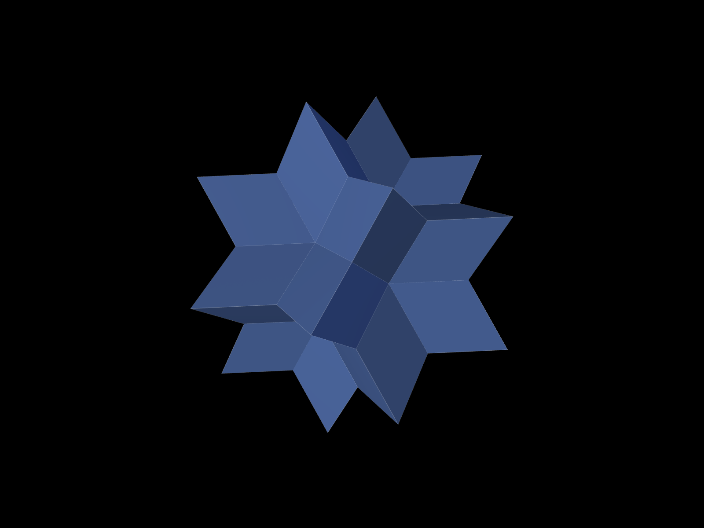

# Hexecontahedra



Interactive 3D models of the 32 hexecontahedra (60-faced polyhedra) listed on
Wikipedia: the 4 convex Catalan solids, the rhombic hexecontahedron, and the
27 duals of the non-convex uniform polyhedra that have 60 vertices.

## Run

Browsers block ES module imports from `file://` URLs, so serve the folder over HTTP:

```sh
npm start                  # http://localhost:8000 (Node 18+, no dependencies)
# or: python3 -m http.server 8000
```

The gallery (`index.html`) links to the viewer (`viewer.html?shape=<id>`).
Viewer controls: drag to rotate, scroll to zoom, `←` `→` for the previous or
next polyhedron. Buttons toggle auto-rotation and edges.

## How the shapes are computed

The coordinates are computed, not typed in.

1. `js/geometry/wythoff.js` builds each uniform polyhedron from its Wythoff
   symbol. It makes the Schwarz triangle, generates the icosahedral reflection
   group, places the generating vertex, and takes the orbits of the generating
   faces. Digons and doubly covered faces are dropped. A snub vertex is found
   with Newton's method; the root inside the Schwarz triangle is used.
2. `js/geometry/dual.js` reciprocates the polyhedron about its midsphere.
3. `js/geometry/polygon.js` triangulates the faces. Many star-dual faces are
   darts, crossed quadrilaterals (antiparallelograms), pentagrams or hexagrams,
   so a simple fan is wrong. The triangulation covers the region where the
   face's winding number is not zero.
4. The rhombic hexecontahedron is one golden rhombus and its 59 images under
   the icosahedral group.

All shapes use the same orientation: 2-fold axes on x, y, z and a 5-fold axis
on (0, 1, φ).

## The 32 polyhedra

| # | Name | Family | Faces | Dual of | Wythoff symbol |
|---|------|--------|-------|---------|----------------|
| 1 | Pentakis Dodecahedron | Catalan solid | Isosceles triangle | truncated icosahedron (U25) | `2 5 \| 3` |
| 2 | Triakis Icosahedron | Catalan solid | Isosceles triangle | truncated dodecahedron (U26) | `2 3 \| 5` |
| 3 | Deltoidal Hexecontahedron | Catalan solid | Kite | rhombicosidodecahedron (U27) | `3 5 \| 2` |
| 4 | Pentagonal Hexecontahedron | Catalan solid | Pentagon | snub dodecahedron (U29) | `\| 2 3 5` |
| 5 | Rhombic Hexecontahedron | Stellation | Golden rhombus | — | — |
| 6 | Small Icosacronic Hexecontahedron | Uniform star dual | Kite | small icosicosidodecahedron (U31) | `5/2 3 \| 3` |
| 7 | Small Hexagonal Hexecontahedron | Uniform star dual | Hexagon | small snub icosicosidodecahedron (U32) | `\| 5/2 3 3` |
| 8 | Small Dodecacronic Hexecontahedron | Uniform star dual | Dart | small dodecicosidodecahedron (U33) | `3/2 5 \| 5` |
| 9 | Small Stellapentakis Dodecahedron | Uniform star dual | Isosceles triangle | truncated great dodecahedron (U37) | `2 5/2 \| 5` |
| 10 | Medial Deltoidal Hexecontahedron | Uniform star dual | Kite | rhombidodecadodecahedron (U38) | `5/2 5 \| 2` |
| 11 | Small Rhombidodecacron | Uniform star dual | Antiparallelogram | small rhombidodecahedron (U39) | `2 5/2 5 \|` |
| 12 | Medial Pentagonal Hexecontahedron | Uniform star dual | Pentagon | snub dodecadodecahedron (U40) | `\| 2 5/2 5` |
| 13 | Great Ditrigonal Dodecacronic Hexecontahedron | Uniform star dual | Kite | great ditrigonal dodecicosidodecahedron (U42) | `3 5 \| 5/3` |
| 14 | Small Ditrigonal Dodecacronic Hexecontahedron | Uniform star dual | Dart | small ditrigonal dodecicosidodecahedron (U43) | `5/3 3 \| 5` |
| 15 | Medial Icosacronic Hexecontahedron | Uniform star dual | Dart | icosidodecadodecahedron (U44) | `5/3 5 \| 3` |
| 16 | Medial Hexagonal Hexecontahedron | Uniform star dual | Concave hexagon | snub icosidodecadodecahedron (U46) | `\| 5/3 3 5` |
| 17 | Great Icosacronic Hexecontahedron | Uniform star dual | Dart | great icosicosidodecahedron (U48) | `3/2 5 \| 3` |
| 18 | Small Dodecicosacron | Uniform star dual | Antiparallelogram | small dodecicosahedron (U50) | `3/2 3 5 \|` |
| 19 | Great Stellapentakis Dodecahedron | Uniform star dual | Isosceles triangle | truncated great icosahedron (U55) | `2 5/2 \| 3` |
| 20 | Rhombicosacron | Uniform star dual | Antiparallelogram | rhombicosahedron (U56) | `2 3 5/2 \|` |
| 21 | Great Pentagonal Hexecontahedron | Uniform star dual | Pentagon | great snub icosidodecahedron (U57) | `\| 2 5/2 3` |
| 22 | Great Pentakis Dodecahedron | Uniform star dual | Isosceles triangle | small stellated truncated dodecahedron (U58) | `2 5 \| 5/3` |
| 23 | Medial Inverted Pentagonal Hexecontahedron | Uniform star dual | Concave pentagon | inverted snub dodecadodecahedron (U60) | `\| 5/3 2 5` |
| 24 | Great Dodecacronic Hexecontahedron | Uniform star dual | Kite | great dodecicosidodecahedron (U61) | `5/2 3 \| 5/3` |
| 25 | Great Dodecicosacron | Uniform star dual | Antiparallelogram | great dodecicosahedron (U63) | `5/3 5/2 3 \|` |
| 26 | Great Hexagonal Hexecontahedron | Uniform star dual | Concave hexagon | great snub dodecicosidodecahedron (U64) | `\| 5/3 5/2 3` |
| 27 | Great Triakis Icosahedron | Uniform star dual | Isosceles triangle | great stellated truncated dodecahedron (U66) | `2 3 \| 5/3` |
| 28 | Great Deltoidal Hexecontahedron | Uniform star dual | Dart | nonconvex great rhombicosidodecahedron (U67) | `5/3 3 \| 2` |
| 29 | Great Inverted Pentagonal Hexecontahedron | Uniform star dual | Concave pentagon | great inverted snub icosidodecahedron (U69) | `\| 5/3 2 3` |
| 30 | Small Hexagrammic Hexecontahedron | Uniform star dual | Hexagram | small retrosnub icosicosidodecahedron (U72) | `\| 3/2 3/2 5/2` |
| 31 | Great Rhombidodecacron | Uniform star dual | Antiparallelogram | great rhombidodecahedron (U73) | `2 5/3 3/2 \|` |
| 32 | Great Pentagrammic Hexecontahedron | Uniform star dual | Pentagram | great retrosnub icosidodecahedron (U74) | `\| 2 3/2 5/3` |

Three of the star duals (small hexagonal, great hexagonal, small hexagrammic)
are partially degenerate: some vertices coincide in pairs, because the uniform
polyhedron has pairs of coplanar faces. Vertex counts include both points of
each pair, as on Wikipedia.

The great dirhombicosidodecacron (dual of U75) is not in Wikipedia's list of 27
and is not included.

## Tests

```sh
npm test
```

The tests use the Node test runner and check:

- each uniform source polyhedron against the vertex, edge and face counts and
  faces by type in Wikipedia's "List of uniform polyhedra", and against its
  published circumradius (Wikipedia articles, Richard Klitzing's polytope
  pages, closed forms);
- each hexecontahedron: 60 planar, congruent faces of the named shape, every
  edge on exactly two faces, and only the Catalan solids convex;
- the triangulation of every face: sampled points are covered exactly when
  the face's winding number there is not zero.

## Project layout

```
index.html, viewer.html    Gallery and viewer pages
css/styles.css
js/catalog.js              The 32 entries: names, Wythoff symbols, face shapes
js/registry.js             Builds and caches the geometry of an entry
js/geometry/               Wythoff construction, dual, triangulation, mesh data
                           (no three.js dependency, so it runs in Node)
js/polyhedra/              Shapes built by hand (rhombic hexecontahedron)
js/render.js               Shared three.js setup
js/index.js, js/viewer.js  Page scripts
scripts/serve.mjs          Local static server
test/                      Geometry tests
```

## Adding a polyhedron

- Dual of a uniform polyhedron: add an entry with its Wythoff symbol to
  `js/catalog.js`.
- Any other shape: write a module that exports a function returning
  `{ vertices, faces }` (each face is a cycle of vertex indices) and set it
  as `build` in the catalog entry.

Then update the expected count in `test/geometry.test.mjs` and run `npm test`.

## Tech

three.js 0.160 from a CDN through an import map, vanilla ES modules, no build step.

## References

- Wikipedia: [Hexecontahedron](https://en.wikipedia.org/wiki/Hexecontahedron),
  [List of uniform polyhedra](https://en.wikipedia.org/wiki/List_of_uniform_polyhedra)
- R. Klitzing, [Polytopes & their incidence matrices](https://bendwavy.org/klitzing/home.htm)
- Z. Har'El, "Uniform solution for uniform polyhedra", *Geometriae Dedicata* 47 (1993) 57–110
- H. S. M. Coxeter, M. S. Longuet-Higgins, J. C. P. Miller, "Uniform polyhedra",
  *Phil. Trans. R. Soc. A* 246 (1954) 401–450
